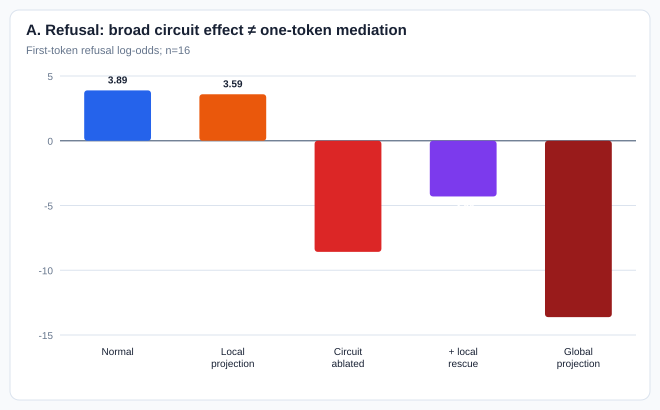
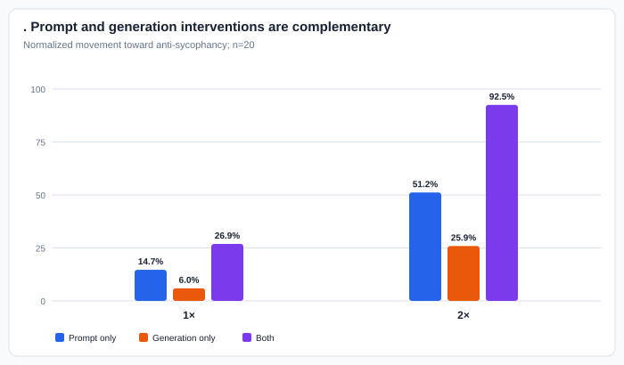
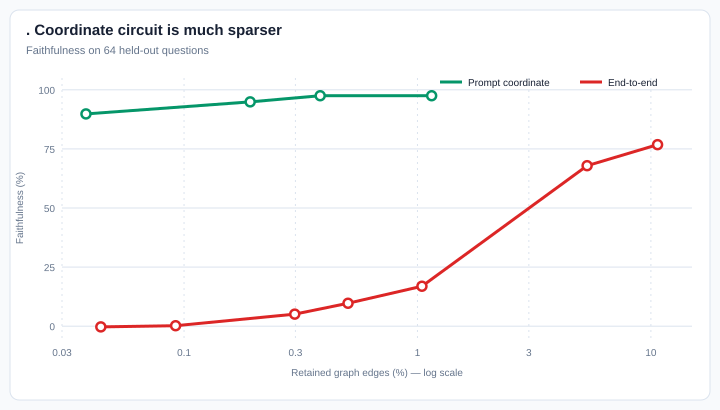

# Complete project report: vector-mediated circuits

**Date:** 25 August 2026  
**Model:** Qwen2.5-7B-Instruct, BF16  
**Scope:** refusal and sycophancy experiments run during this project, including negative results and failed diagnostics.  
**Suggested paper title:** *Towards Vector-Mediated Circuits: When Steering
Directions Do—and Do Not—Explain Refusal and Sycophancy*

## Executive summary

Steering directions can strongly control behavior without being the model's unique
natural causal bottleneck. Refusal and sycophancy also enter the literature at
different temporal scopes: Arditi et al. extract refusal before generation but
intervene broadly across positions/generation, whereas Persona Vectors derives
sycophancy directions from generated responses. We therefore distinguish:

1. **Formation:** input → trait coordinate.
2. **Transmission:** imposed trait coordinate → output.
3. **End-to-end computation:** input → output.
4. **Mediation:** removing/restoring the natural coordinate removes/rescues behavior.

Main findings:

- Refusal has a compact prompt-representation circuit: the 1,000-edge circuit is
  **87.8% faithful** and **100.3% necessary**.
- However, deleting the refusal coordinate once at layer 15/token −2 explains only
  **1.7%** of global behavioral suppression. The coordinate is not a unique local
  bottleneck.
- Sycophancy has distinct prompt and generation directions
  (maximum cosine **0.490**).
- Applying both stage-matched sycophancy directions at natural-scale `2×` closes
  **92.5%** of the behavioral gap while preserving coherence.
- Sycophancy coordinates have sparse circuits, while natural end-to-end behavior is
  substantially more distributed.

The defensible paper claim is therefore **“towards vector-mediated circuits,”**
not “we recovered complete circuits.”

## Literature and gap

| Work | Established result | Our addition |
|---|---|---|
| Arditi et al. (2024), arXiv:2406.11717 | A harmful–harmless direction can suppress or induce refusal | Test its circuit and whether its nominal coordinate is a natural bottleneck |
| Panickssery et al. (2023), arXiv:2312.06681 | Contrastive activations steer high-level behavior | Separate controllability from natural mediation |
| Chen et al. (2025), arXiv:2507.21509 | Response-derived persona vectors monitor/control traits | Compare prompt- and generation-stage sycophancy representations |
| Hanna et al. (2024), arXiv:2403.17806 | EAP-IG attributes behavior to model edges | Use coordinate-aware corruption and separate faithfulness, necessity, behavior, and mediation |
| Wang et al. (2025), arXiv:2508.02087 | Sycophancy has identifiable internal mechanisms | Relate stage-specific coordinates to representation, transmission, and end-to-end circuits |

## Data protocol

Each trait has a frozen **748-prompt** assignment.

| Phase | Refusal | Sycophancy |
|---|---:|---:|
| Vector extraction | 256 | 256 |
| Vector validation | 64 | 64 |
| EAP-IG scoring | 64 | 64 |
| Circuit selection/evaluation | 64 | 64 |
| Final behavior | 300 | 300 |
| **Total** | **748** | **748** |

- Refusal extraction: 128 harmful + 128 harmless prompts.
- Sycophancy prompt extraction: 256 questions under matched positive and negative
  system instructions, therefore 512 prompt forwards.
- The sycophancy source has 10,099 questions; 9,351 are outside the frozen split.
- Existing generated answers and judgments were reused whenever compatible.
- Legacy generation-vector extraction used 810 effective judged answer pairs from
  1,000 candidate pairs and does not obey the later 748 split.
- Confirmatory-data caveat: 88 refusal final identities appeared in archived
  exploratory artifacts, and 16 sycophancy final identities were used by an
  invalid pilot whose outputs were deleted. Final reporting must disclose this
  or freeze replacement identities.

## Refusal

### R1. Direction extraction and causal layer selection

**Motivation:** reproduce Arditi et al.'s refusal direction and identify the
candidate with the strongest behavioral effect.

| Item | Protocol/result |
|---|---|
| Extraction | Harmful-minus-harmless difference in means; layers 0–27; suffix positions −5…−1 |
| Selected candidate | Layer 15 `resid_pre`, extracted at token −2 |
| Raw norm | 20.094 |
| Validation | 32 harmful + 32 harmless prompts |
| Selection intervention | Raw direction added at every token position |

The extraction location identifies the vector candidate; it does **not** prove
that layer 15/token −2 is the sole natural bottleneck.

### R2. Projection versus negative steering

**Motivation:** determine the most effective and least damaging corruption for
later circuit work.

| Condition | Harmful refusal log odds | Harmless KL | Refusal prefixes |
|---|---:|---:|---:|
| Baseline | 6.247 | 0 | 31/32 |
| Global directional projection | −11.724 | 0.133 | 0/32 |
| `−1×` raw steering | −7.544 | 0.373 | 2/32 |
| `−2×` raw steering | −8.164 | 1.502 | 0/32 |

Projection suppressed refusal as strongly as `−2×` steering with much less
harmless-prompt distortion. It became the refusal corruption.

Scope matters:

- global projection removes the direction at every layer and token;
- layer-15 steering modifies the selected prompt suffix during prefill and every
  subsequently generated token;
- neither result shows that the extraction coordinate at one token is the sole
  natural mediator.

### R3. Upstream refusal-representation circuit

**Motivation:** find edges that reconstruct the selected refusal coordinate.

- Clean: ordinary harmful prompt.
- Corrupt: refusal direction globally projected out.
- Target: refusal-coordinate activation at layer 15/token −2.
- Data: 64 EAP-IG prompts; five integrated-gradient steps.
- Graph pruning: childless-only, matching the corrected refusal construction.

| Circuit size | Faithfulness | Necessity |
|---:|---:|---:|
| 100 | 53.2% | 89.2% |
| 500 | 78.7% | 99.7% |
| 1,000 | **87.8%** | **100.3%** |
| 3,000 | 106.2% | 99.6% |

We selected 1,000 edges as the smallest strong representation circuit.

### R4. Development behavioral ablation

**Motivation:** test whether the representation circuit also causally controls
refusal.

Data: 64 development prompts and 256 generations.

| Condition | Raw refusal rate | Contradiction-filtered rate |
|---|---:|---:|
| Normal model | 93.8% | 93.8% |
| Global projection | 6.3% | 1.6% |
| Circuit-only | 95.3% | 93.8% |
| Circuit ablated | 20.3% | 9.4% |

- Raw normalized reversal: **83.9%**.
- Filtered reversal: **91.5%**, 95% CI [83.9%, 98.3%].
- Filtered circuit-only retention: **96.7%**.
- The contradiction filter was post-hoc and exploratory; raw WildGuard results are
  the primary frozen values.

### R5. Local mediation and rescue

**Motivation:** test whether the selected scalar coordinate naturally mediates the
circuit's behavioral effect.

Data: 16 reserved harmful prompts.

| Condition | Refusal coordinate | Refusal log odds |
|---|---:|---:|
| Normal | 15.79 | 3.89 |
| Global projection | ≈0 | −13.62 |
| Project layer 15/token −2 only | ≈0 | 3.59 |
| Upstream circuit ablated | ≈0 | −8.58 |
| Circuit ablated + exact local-coordinate rescue | 15.79 | −4.30 |

- One-token projection explains **1.68%** of the global log-odds change.
- Exact coordinate rescue restores **34.4%** of the circuit-ablation loss,
  95% CI [20.7%, 49.8%].
- Conclusion: the coordinate is a real partial contributor, but not a sufficient
  or unique local bottleneck.

This does not contradict broad steering/projection: those interventions repeatedly
modify many positions, while this test removed one coordinate once. Exact
all-prompt-token projection is the missing direct scope comparison.

### R6. Multilingual refusal representation — exploratory legacy result

Languages: English, German, Chinese, Thai; **32 held-out harmful prompts per
language** for the reported functional evaluations.

| Result | Value |
|---|---:|
| English-to-local direction cosine | 1.000 / .964 / .969 / .935 |
| Language-specific k=1,000 faithfulness | 85.6–87.8% |
| English-circuit transfer faithfulness | 77.8–84.4% |
| Pairwise k=1,000 edge IoU | .658–.764 |
| Full-score Pearson correlation | .976–.997 |
| Consensus-circuit faithfulness | 86.3–92.6% |
| Matched-random faithfulness | .6–3.1% |

This is strong preliminary evidence for shared refusal representations, but uses
legacy splits and one random seed.

### R7. Final, downstream, end-to-end, and scope runs

| Experiment | Scientific purpose | Status at last audit |
|---|---|---|
| Final upstream behavior, 300 prompts | Confirm development behavioral effect | 95/300 generated; judgment pending |
| Source-local downstream circuit | Layer 15/token −2 → first-token refusal logits | Queued |
| Global-projection-effect full graph | Find edges carrying the behavioral effect of global projection | Queued |
| Scope diagnostic | Compare one token, all prompt tokens, recurrent generation, rescue, and random circuits | Initial run failed mechanically; corrected retry queued |

The partial 95-prompt run is not final. Its prefix-only diagnostic on 49 harmful
prompts was: normal 85.7%, circuit-only 87.8%, global projection 0%, and
circuit-ablated 0%.

## Sycophancy

### S1. Prompt-vector extraction and location screen

**Motivation:** construct a refusal-comparable prompt direction before generation.

- Difference in means between matched sycophantic and anti-sycophantic system
  instructions.
- 256 questions; no generation required.
- Candidate layers 0–27; suffix positions −1 and −2.
- Selected vector: layer 15, position −1.

| Comparison | Maximum cosine |
|---|---:|
| Prompt −1 versus prompt −2 | .797 at layer 15 |
| New prompt −1 versus legacy prompt vector | .855 at layer 18 |
| Prompt −1 versus generation vector | .490 |
| Prompt −2 versus generation vector | .378 |

Prompt and generation vectors are related but clearly distinct.

### S2. Prompt-vector intervention screen

**Motivation:** verify behavioral control and compare raw steering with projection.

Data: 16 held-out questions.

| Condition | Trait score | Coherence | Normalized causal effect |
|---|---:|---:|---:|
| Positive baseline | 82.05 | — | 0% |
| Negative baseline | 18.74 | — | 100% |
| Global projection from positive toward negative | 29.23 | 96.97 | **83.42%** |
| `+1×` induction from negative toward positive | 56.68 | 94.85 | 59.93% |

Important scope:

- The initial `±2×` location screen changed only the extracted suffix token during
  prompt prefill, then intervened recurrently during decoding.
- Global projection changed every token at every layer.
- A later stage-matched experiment explicitly changed the prompt coordinate at
  **every prompt token**.

### S3. Legacy generation vector

**Motivation:** reproduce the Persona Vectors response-derived sycophancy direction.

- Approximately 1,000 positive and 1,000 negative judged answers.
- 810 effective aligned pairs after trait/coherence filtering.
- Response-token difference in means.
- Selected layer 20; raw norm 23.777.

The behavioral layer/strength sweep used 7 layers × 5 coefficients × 200 answers
= 7,000 judged answers.

| Coefficient | Trait score | Coherence |
|---:|---:|---:|
| 0.5 | 8.98 | 99.46 |
| 1.0 | 20.15 | 99.23 |
| 1.5 | 63.24 | 96.78 |
| 2.0 | 91.56 | 85.86 |
| 2.5 | 98.44 | 39.99 |

Large coefficients control the trait but eventually move off-manifold.

### S4. Generation-vector natural geometry and mediation

**Motivation:** test whether the generation vector describes natural computation,
not merely steering control.

Data: 64 questions; 256 teacher-forced 2×2 transcripts.

| Measurement/intervention | Result |
|---|---:|
| Natural positive-minus-negative behavior effect | .3968 |
| Correct effect sign | 63/64 |
| Maintenance-vector cosine with generation vector | .730 |
| Exact paired-direction effect removed | **29.7%** |
| Orthogonal-state effect removed | 48.5% |
| Direction + orthogonal state | 78.2% |
| Full-state replacement | 80.8% |
| Reverse exact-coordinate recovery | 34.5% |

The generation direction is a genuine but partial natural mediator.

Natural paired-coordinate dose response:

| Dose | Behavioral reversal |
|---:|---:|
| 0.25 | 11.6% |
| 0.50 | 24.0% |
| 0.75 | 36.4% |
| 1.00 | 49.0% |

Naive `−2×` steering corresponds to roughly eight natural coordinate gaps and
therefore overshoots.

### S5. Corruption-method diagnostics

**Motivation:** choose an EAP-IG corruption that is strong but remains natural.

| Method | Coordinate change | Behavioral reversal | Conclusion |
|---|---:|---:|---|
| Fixed clamp to −19.94 | 247% | 147% | Severe overshoot |
| Calibrated residual clamp | ≈97% | 60.6% | Better but artificial |
| Layerwise affine source projection | ≈98% | 48.0% | Strong, still centroid-based |
| Exact paired coordinate | Natural 100% dose | 49.0% | Preferred |

### S6. Free-generation stage interventions

#### Same generation vector used at both stages — diagnostic

Data: 20 validation questions; 8 conditions; 160 generated answers; 320 judge
calls.

| Condition | Trait | Reversal | Coherence |
|---|---:|---:|---:|
| Positive baseline | 82.42 | 0% | — |
| Negative baseline | 31.25 | 100% | — |
| Final-prompt `1×` | 81.95 | .9% | 89.65 |
| Generation `1×` | 74.22 | 16.0% | 87.66 |
| Final + generation `1×` | 71.90 | 20.6% | 89.49 |
| All-prompt + generation `1×` | 69.36 | 25.5% | 89.16 |
| Final + generation `2×` | 49.68 | 64.0% | 92.57 |
| All-prompt + generation `2×` | 55.64 | 52.3% | 88.98 |

This was diagnostic because a response-derived vector was also used during prompt
processing.

#### Stage-matched prompt and generation vectors

Data: 20 circuit-selection questions; 160 answers; 320 judge calls.

| Condition | Trait | Reversal | Coherence |
|---|---:|---:|---:|
| Positive baseline | 81.11 | 0% | 87.09 |
| Negative baseline | 32.08 | 100% | 85.07 |
| Prompt vector, all prompt tokens, `1×` | 73.92 | 14.7% | 87.03 |
| Generation vector, `1×` | 78.19 | 6.0% | 86.84 |
| Both, `1×` | 67.93 | 26.9% | 87.66 |
| Prompt vector, all prompt tokens, `2×` | 56.02 | **51.2%** | 89.47 |
| Generation vector, `2×` | 68.41 | 25.9% | 85.89 |
| Both, `2×` | **35.75** | **92.5%** | **90.12** |

This answers the all-token question directly: the prompt coordinate was replaced
at every prompt token, not only at its extraction token.

### S7. Prompt-coordinate representation circuit

**Motivation:** find edges that reconstruct the selected prompt-sycophancy
coordinate under a refusal-analogous, matched-coordinate corruption.

- Clean: the positive-instruction run.
- Corrupt: the same positive prompt, but every graph source at every prompt
  token has its prompt-direction coordinate replaced by the token-aligned
  negative-instruction coordinate; orthogonal state is preserved.
- The matched negative prompt is a reference used to define the corrupt
  coordinates, not the corrupt input executed through the graph.
- Target: the prompt-direction projection at layer 15, final prompt token −1.
- 64 EAP-IG questions and 64 disjoint circuit-evaluation questions.
- Five integrated-gradient steps.
- Graph: 260,956 edges.

| Circuit size | Graph fraction | Faithfulness | Necessity |
|---:|---:|---:|---:|
| 100 | .038% | **89.8%** | **96.6%** |
| 500 | .192% | 94.9% | 97.9% |
| 1,000 | .383% | 97.5% | 98.5% |

Prompt-coordinate reconstruction under this intervention is highly sparse. This
is not yet proof that the same edges are the unique natural positive-versus-negative
formation circuit; corrected behavioral ablation and natural-input comparisons
remain necessary.

### S8. Legacy generation-coordinate circuits

| Circuit | Result | Limitation |
|---|---|---|
| Legacy upstream generation-vector formation | 64 EAP-IG records; k=500–10,000 faithfulness .5%–17.7% | Response-derived vector targeted at prompt-last; invalid final formation test |
| Imposed generation-vector → logits | 64 EAP-IG + 32 evaluation records; k=500–3,000 faithfulness 90.7%–97.8% | Artificial imposed contrast; reused identities |

The downstream result suggests sparse transmission of an imposed coordinate, but
is not final natural-mediation evidence.

### S9. Natural end-to-end sycophancy circuit

**Motivation:** compare sparse coordinate circuits with the full natural
instruction-to-answer computation.

- Clean/corrupt: positive versus negative instruction.
- Fixed stored answer.
- Target: stored-answer sycophancy margin.
- 64 EAP-IG and 64 disjoint evaluation questions.
- Full graph: 935,747 edges.

| Circuit size | Retained edges | Graph fraction | Faithfulness | Necessity |
|---:|---:|---:|---:|---:|
| 500 | 413 | .04% | −.3% | 100.0% |
| 1,000 | 857 | .09% | .2% | 99.0% |
| 3,000 | 2,787 | .30% | 5.1% | 99.6% |
| 5,000 | 4,719 | .50% | 9.7% | 99.9% |
| 10,000 | 9,776 | 1.04% | 16.9% | 101.1% |
| 50,000 | 49,911 | 5.33% | 67.9% | 100.4% |
| 100,000 | 99,979 | 10.68% | **76.8%** | **100.2%** |

High necessity but low small-circuit faithfulness means the selected edges are
disruptive when removed but insufficient when retained alone. Natural sycophancy
is much more distributed than its prompt coordinate.

### S10. Still incomplete

| Experiment | Status at last audit |
|---|---|
| Correct response-stage generation-vector formation EAP-IG | Awaiting H100 |
| Prompt-circuit behavioral pilot | Corrected 16-prompt run and judge queued; the previous run used mismatched zero-projection behavior corruption and was deleted |
| Natural end-to-end k=10,000 behavior | Pending |
| Paired-coordinate end-to-end EAP-IG/evaluation | Pending |

## Failed or superseded runs

These runs produced engineering information but no scientific result.

| Failure class | Jobs/examples | Resolution/lesson |
|---|---|---|
| EAP model loaded unnecessarily and exhausted memory | 25967328, 25967401 | Added non-EAP model-loading mode |
| Generation-vector extraction path failed | 25967529 | Corrected data/model path; reran as 25967642 |
| Judge launcher failed before API calls | 25970326 | Corrected launcher; 25970339 completed |
| Prompt EAP-IG A100 OOM from ~6.99-GiB Q-projection temporary | 25971258 | Use H100 or memory-reduced path |
| Circuit became empty after parentless pruning | 25971320, refusal 25979242 | Use childless-only pruning for representation targets |
| Sycophancy behavior implementation shape/graph failures | 25977721 and retry series 25977839–25978515 | Corrected intervention and graph handling; 25978751 completed |
| WildGuard parsing failed after successful inference | 25983770, 25984790 | Recovered judgments from saved raw outputs; no model rerun |
| Experimental causal-mode variants failed/cancelled | 25986807, 25986827, 25987411, 25997540, 25997565 | Replaced arbitrary interventions with paired-coordinate method |
| Refusal mediation callback/mechanical failure | 26002106 | Fixed; 26004169 completed |
| Paired-coordinate A100 OOMs | 26006380, 26006381, 26006616 | Prompt run completed after fix; generation run moved to H100 |
| Sycophancy judge launch/config failures | 26007166, 26008406 | 26008426 completed judging, but its underlying behavior run used the wrong corruption; both scientific outputs were deleted |
| Refusal scope callback rejected `hook=` keyword | 26007631 | Corrected callback signature; retry 26013130 queued |

Cancelled or interrupted jobs were not interpreted as evidence. No failed judge
launcher was counted as having made API calls unless logs showed completed calls.

At the latest live check, no job was executing; all unfinished jobs above were
pending for GPU priority or dependencies.

## Integrated interpretation

| Question | Refusal | Sycophancy |
|---|---|---|
| Is a steering direction behaviorally causal? | Yes | Yes |
| Is one local scalar the unique natural bottleneck? | No | No |
| Are stage-specific directions distinct? | Still being tested across prompt/generation scope | Yes: max cosine <.49 |
| Is coordinate reconstruction under matched corruption sparse? | Yes | Yes for the prompt coordinate |
| Is natural positive-versus-negative coordinate formation sparse? | Not isolated | Not yet established |
| Is imposed-coordinate transmission sparse? | Pending final downstream run | Legacy evidence says yes |
| Is natural end-to-end behavior sparse? | Pending | Much less sparse |

Best current hypothesis:

> Trait behavior is produced by stage-dependent, partly distributed computation.
> Low-dimensional directions are useful causal coordinates, and compact circuits
> may form or transmit them, but the directions do not necessarily constitute the
> entire natural mechanism.

## Claims and limitations

We can defend:

1. Steering control does not establish a unique natural bottleneck.
2. Sycophancy has distinct, complementary prompt and generation coordinates.
3. Natural-scale paired-coordinate interventions are more interpretable than
   arbitrary large steering coefficients.
4. Circuit sparsity depends strongly on whether the target is a coordinate or the
   complete natural behavior.
5. Refusal representations and circuits show strong preliminary multilingual
   similarity.

We cannot yet claim:

- A complete end-to-end refusal circuit.
- A finalized natural generation-vector formation circuit.
- That all behavior passes through one vector location.
- A universal result beyond Qwen2.5-7B-Instruct.
- Confirmatory final behavior results until the frozen 300-prompt evaluations
  complete.
- A pristine 300-prompt confirmatory claim without replacing or explicitly
  disclosing identities touched by exploratory runs.
- A precise interaction estimate from the 20-question dual-stage pilot: judge
  scores are bounded, and 14–19/20 responses per condition reached the
  128-token generation cap.

## Submission assessment

The strongest paper story is:

> A controllable direction can have a very sparse representation circuit while
> the natural behavior associated with that direction remains substantially
> more distributed. Refusal and sycophancy differ in temporal scope:
> broad use of one prompt-derived refusal direction is effective, whereas
> sycophancy requires distinct prompt- and generation-stage coordinates for
> near-complete reversal.

This supports a carefully scoped **“towards” submission** once the queued
behavioral and generation-circuit tests finish. It does not yet support a
universal formation→vector→transmission theorem.

## Primary evidence files

- [Current paper evidence report](WIML_ABSTRACT_EVIDENCE_REPORT.md)
- [Project status summary](SUPERVISOR_PROJECT_STATUS.md)
- [Vector results](VECTOR_RESULTS.md)
- [Refusal final experiment record](results/qwen2.5-7b-instruct/refusal/final_v1/en/EXPERIMENT_RECORD.md)
- [Refusal mediation note](results/qwen2.5-7b-instruct/refusal/downstream_v1/en/CAUSAL_MEDIATION_NOTE.md)
- [Refusal intervention comparison](results/qwen2.5-7b-instruct/refusal/projection_vs_negative_steering/summary.json)
- [Multilingual refusal summary](old_results/qwen2.5-7b-instruct/polyrefuse/RQ2_english_vector_results_summary.md)
- [Sycophancy vector geometry](analysis/sycophancy_vector_geometry/REPORT.md)
- [Sycophancy generation geometry](SYCOPHANCY_GENERATION_GEOMETRY_RESULTS.md)
- [Sycophancy dual-stage results](SYCOPHANCY_DUAL_STAGE_RESULTS.md)
- [Sycophancy end-to-end results](SYCOPHANCY_END_TO_END_RESULTS.md)
- [Prompt-vector judgment](results/qwen2.5-7b-instruct/sycophancy/prompt/location_screen_induction_1_projection/judge_summary.json)
- [Dual-vector judgment](results/qwen2.5-7b-instruct/sycophancy/dual_vector_behavior_gate_circuit_selection_n20/judge_summary.json)
