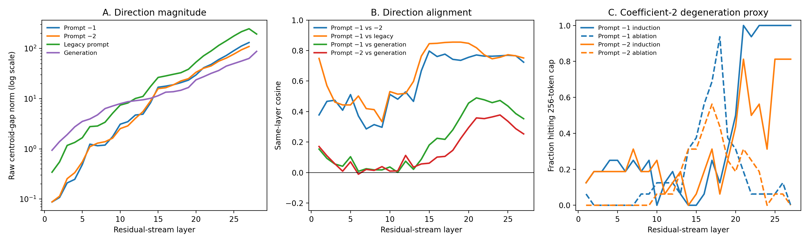

# Sycophancy vector geometry

## Scope

We compare four difference-in-means directions in
`Qwen/Qwen2.5-7B-Instruct`:

- **Prompt −1:** 256-question paired-system vector at the final newline.
- **Prompt −2:** the same contrast at the preceding `assistant` token.
- **Legacy prompt:** the earlier prompt-last vector.
- **Generation:** the response-token vector from 810 effective judged pairs.

All layer indices denote the same residual-stream location. Full per-layer
values and artifact hashes are stored in the accompanying CSV/JSON files.

## Main findings

### 1. The new prompt vector reproduces the legacy prompt direction

| Comparison | Mean cosine, layers 15–20 | Peak same-layer cosine |
|---|---:|---:|
| Prompt −1 vs legacy prompt | **0.851** | **0.855**, layer 18 |
| Prompt −2 vs legacy prompt | 0.635 | 0.654, layer 15 |

The strong Prompt −1 replication suggests that the new 256-question extraction
recovers the same prompt-stage feature despite using a different dataset
sample. Its scale differs substantially from the legacy vector, so raw
coefficients are not directly transferable between those extractions.

### 2. Positions −1 and −2 are related but not interchangeable

Their mean cosine over layers 15–20 is `0.761`, peaking at `0.797` at layer 15.
Thus both suffix tokens encode a shared sycophancy-related component, alongside
position-specific components.

### 3. Prompt and generation vectors are geometrically distinct

| Comparison | Mean cosine, layers 15–20 | Maximum cosine |
|---|---:|---:|
| Prompt −1 vs generation | **0.287** | **0.490**, layer 21 |
| Prompt −2 vs generation | **0.155** | **0.378**, layer 24 |
| Legacy prompt vs generation | 0.340 | 0.528, layer 21 |

Searching across different target layers does not produce a stronger maximum.
The prompt–generation difference therefore cannot be explained by a simple
one- or two-layer index shift. The legacy prompt vector shows the same
separation, so this is also unlikely to be an artifact of the new extraction.

### 4. Coefficient semantics are identical, but absolute shifts differ

For any DIM vector `d = μ_syc − μ_non`:

- `+1d` translates the non-sycophantic centroid exactly to the sycophantic
  centroid.
- `+2d` passes through that centroid and lands one complete centroid gap beyond
  it.
- The equivalent statements hold for negative steering from `μ_syc`.

Therefore, centroid overshoot is **not unique to the prompt vector**: the
successful generation-vector coefficient `2` also overshoots its centroid.
The important differences are direction, scale, and intervention timing.

At layer 20:

| Vector | Raw centroid gap | `2×` shift | Relative to generation shift |
|---|---:|---:|---:|
| Generation | 23.777 | 47.554 | 1.000× |
| Prompt −1 | 29.757 | 59.514 | **1.251×** |
| Prompt −2 | 33.625 | 67.251 | **1.414×** |

The response vector is extracted from response tokens and steered at response
tokens. The prompt vectors are extracted from one prompt-suffix token but were
then applied recurrently to every decode step. Their coefficient is
centroid-calibrated only at the extraction token, not at response-token states.

### 5. Late-layer magnitude is associated with degeneration under `2×`

From layer 15 to 27, the raw centroid gap grows by:

| Vector | Layer-27 / layer-15 norm |
|---|---:|
| Prompt −1 | **7.78×** |
| Prompt −2 | **6.91×** |
| Generation | 5.53× |

Across layers, induction degeneration increases with prompt-vector norm:

| Position | Metric | Pearson with log norm | Spearman with norm |
|---:|---|---:|---:|
| −1 | 256-token-cap rate | **0.655** | 0.578 |
| −1 | repeated 4-gram fraction | **0.665** | 0.661 |
| −2 | 256-token-cap rate | **0.614** | 0.624 |
| −2 | repeated 4-gram fraction | 0.517 | **0.667** |

For Prompt −1 induction, layers 21 and 23–27 hit the 256-token limit on every
question. The highest mean repetition occurred at layer 25: mean repeated
4-gram fraction `0.735`, with an absolute `2×` shift norm of `181.424`.

These correlations are descriptive: layer and vector norm strongly covary, so
they do not independently establish that magnitude causes degeneration.

## Interpretation

The evidence supports a stage-dependent representation:

- prompt vectors encode the model's instruction-conditioned disposition before
  answering;
- the generation vector encodes the response-time realization or maintenance
  of sycophantic behaviour.

This explains why recurrent coefficient `2` can work well for the generation
vector while destabilizing some prompt-vector locations. The geometry does not
show that coefficient `2` is universally invalid for prompt vectors—several
mid-layer outputs remain coherent—but coefficients should be calibrated
separately for each vector type and intervention timing.

## Limitations

- The causal-screen answers still lack Persona trait and coherence scores.
  Token-cap and repetition rates are only degeneration proxies.
- Saved artifacts contain centroids but not per-example activation covariance,
  so within-class scatter, Fisher separation, and linear classification
  accuracy cannot yet be calculated.
- Geometry alone cannot select the final causal layer or determine whether
  projection or centroid-matched steering is the better EAP-IG target.

