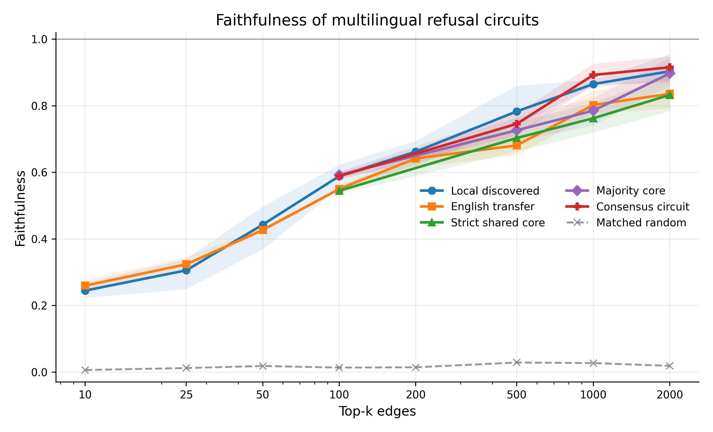
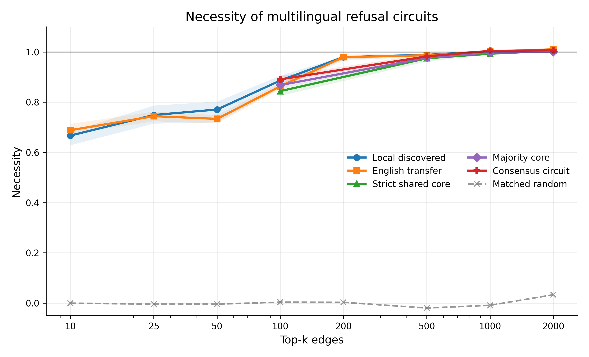
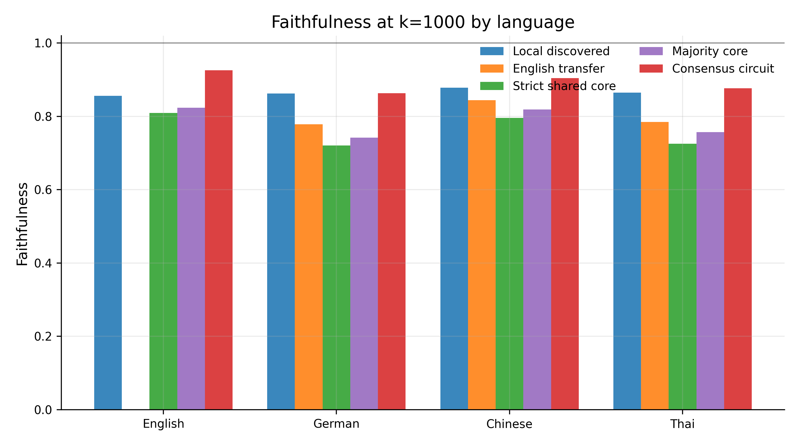
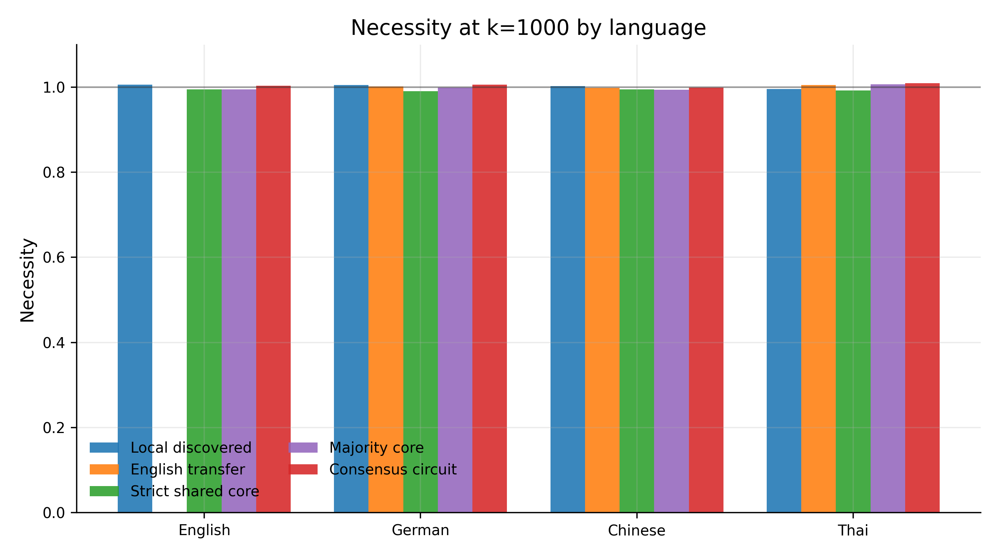
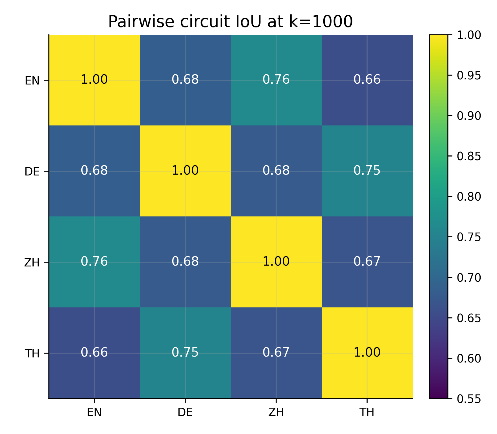
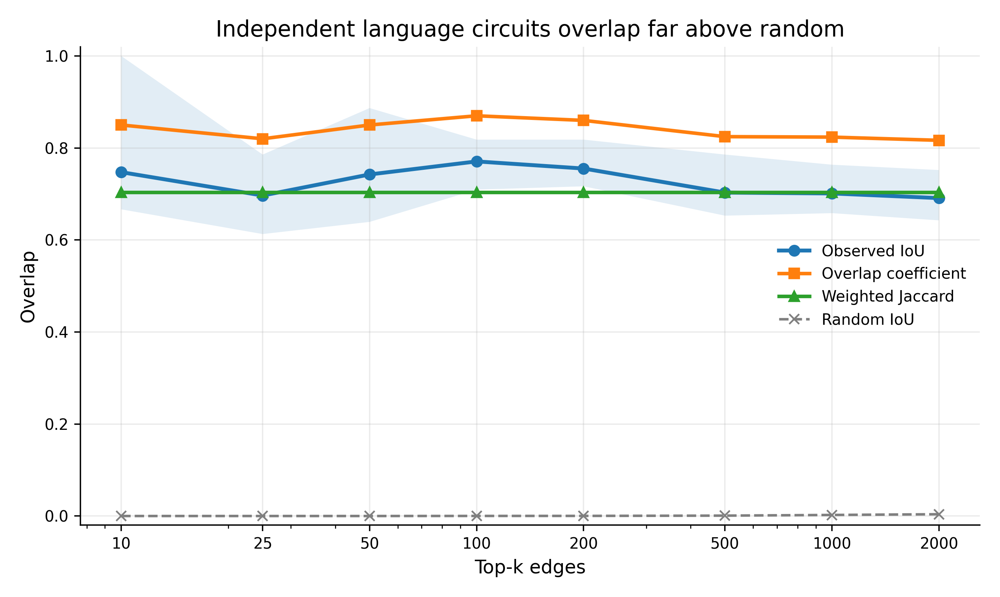
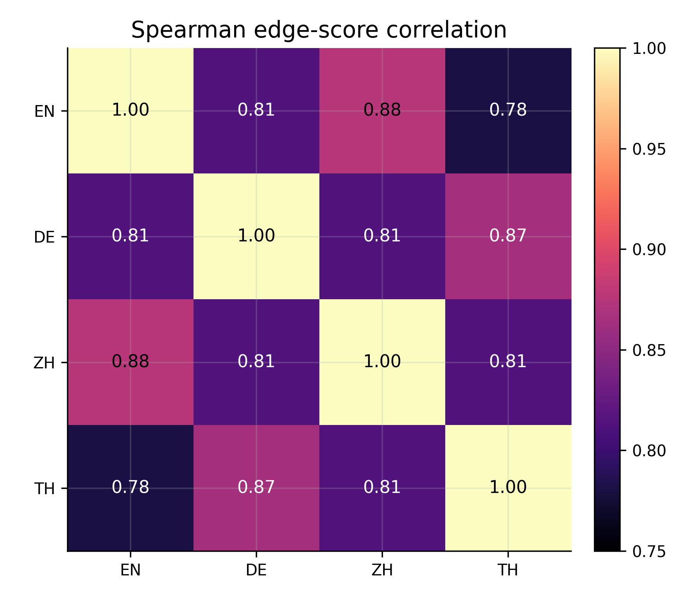
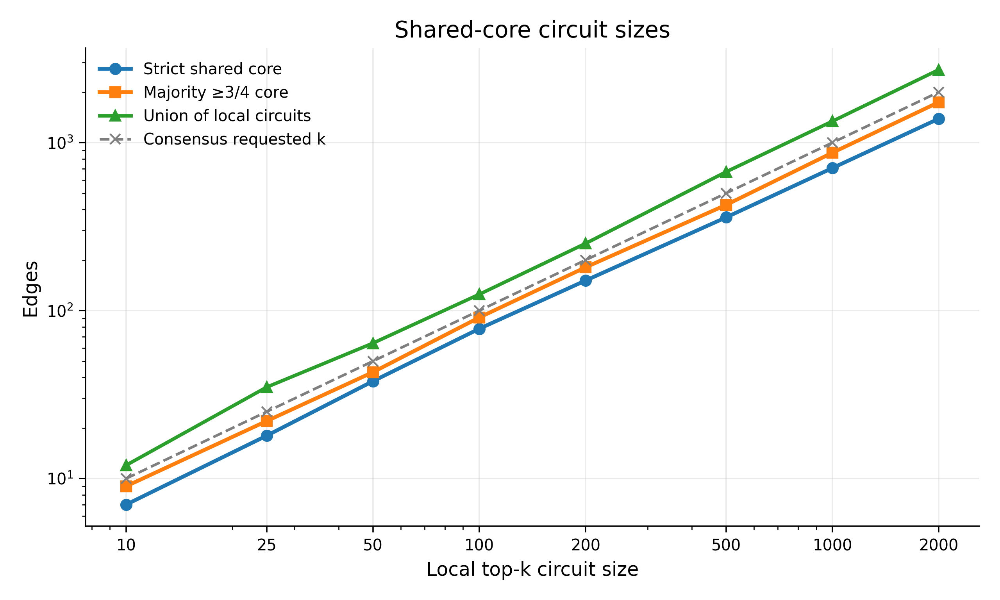
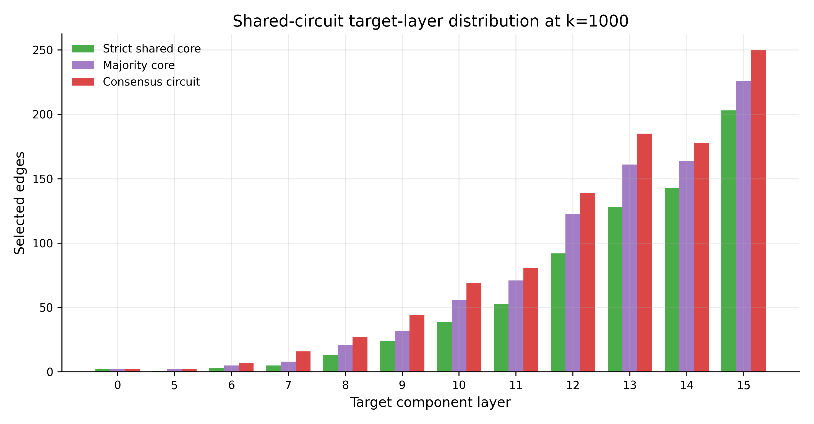

# RQ2 progress update: multilingual refusal circuits

Date: 2026-06-30
Branch: `rq2-multilingual-refusal-circuits`

## TL;DR

We have a strong positive result for the multilingual extension of our refusal-circuit project.

Using `Qwen/Qwen2.5-7B-Instruct` on PolyRefuse prompts in English, German, Chinese, and Thai, we find evidence for a shared multilingual edge-level circuit upstream of a common refusal-direction representation.

In short:

- The English refusal vector at a fixed common anchor transfers well to the other languages.
- Circuits discovered independently in each language overlap much more than random circuits.
- The English circuit transfers functionally to German, Chinese, and Thai.
- A strict shared circuit, consisting only of edges found in all four language circuits, is still faithful and necessary.
- A consensus circuit built by averaging multilingual edge scores performs extremely well across all four languages.

The strongest current claim is:

> In Qwen2.5-7B-Instruct, for English, German, Chinese, and Thai PolyRefuse prompts, we find evidence for a shared multilingual edge-level circuit that causally mediates a common refusal-direction representation at layer 15, token position -2.

Important caveat: this is a circuit for a residual-stream refusal-direction projection, not yet a full prompt-to-generated-refusal behavior circuit.

## What we did

We extended the earlier RQ1 setup from a single English refusal circuit to a multilingual setting.

Model:

- `Qwen/Qwen2.5-7B-Instruct`

Dataset:

- PolyRefuse

Languages:

- English (`en`)
- German (`de`)
- Chinese (`zh`)
- Thai (`th`)

Primary scalar metric:

\[
M_{\mathrm{en}}(x)=h_{15,-2}(x)^\top \hat r_{\mathrm{en}}
\]

where \(h_{15,-2}(x)\) is the residual-stream activation at layer 15 and token position -2, and \(\hat r_{\mathrm{en}}\) is the normalized English refusal direction at the same common anchor.

This is deliberately a shared metric across languages. We did not let each language choose its own layer/token endpoint for the main circuit comparison, because otherwise low or high circuit overlap could be partly an artifact of asking EAP-IG to explain different targets.

Circuit discovery used our intervention-aware EAP-IG adaptation:

- clean state: normal harmful prompt forward pass;
- corrupt state: same harmful prompt with global refusal-direction ablation;
- interpolation path: ablation strength from fully ablated to clean;
- target metric: residual projection \(h_{15,-2}^{\top}\hat r_{\mathrm{en}}\), not a logit metric.

No harmful completions were written to disk in these runs.

## Direction sanity check

The English common-anchor refusal vector is strongly aligned with the language-local common-anchor directions.

| Language | Cosine with English vector | Harmful clean-corrupt projection drop | Refusal log-odds clean → corrupt |
|---|---:|---:|---:|
| English | 1.000 | 16.42 | 5.61 → -12.27 |
| German | 0.964 | 15.20 | 1.75 → -7.70 |
| Chinese | 0.969 | 19.63 | 2.34 → -14.88 |
| Thai | 0.935 | 14.78 | 1.38 → -6.94 |

Interpretation: the English vector is not merely an English-specific artifact. Ablating it substantially reduces the refusal-direction projection and the first-token refusal log-odds in all four languages.

## Main circuit results

We evaluate circuits with two normalized causal metrics.

Faithfulness:

\[
F(C)=\frac{M_{\text{circuit-only}}-M_{\text{corrupt}}}{M_{\text{clean}}-M_{\text{corrupt}}}
\]

Necessity:

\[
N(C)=\frac{M_{\text{clean}}-M_{\text{circuit-ablated}}}{M_{\text{clean}}-M_{\text{corrupt}}}
\]

Intuition:

- Faithfulness asks whether keeping only the circuit preserves the refusal-direction representation.
- Necessity asks whether ablating the circuit removes the refusal-direction representation.
- Values near 1 are strong. Matched random circuits should be near 0.

### Faithfulness across circuit sizes

The consensus circuit is strongest, but all non-random circuit families are far above random. Even the strict shared core, which keeps only edges common to all four independently found language circuits, is substantially faithful.

### Necessity across circuit sizes

Necessity rises quickly and approaches ~1 for relatively modest circuit sizes. This suggests that the selected edges are not merely sufficient-ish; ablating them removes almost all of the relevant refusal-direction projection.

### k=1000 summary

At k=1000, the results are especially clean.

| Circuit family | English F/N | German F/N | Chinese F/N | Thai F/N |
|---|---:|---:|---:|---:|
| Local independently discovered | 0.856 / 1.006 | 0.862 / 1.005 | 0.878 / 1.003 | 0.865 / 0.996 |
| English circuit transferred | — | 0.778 / 1.002 | 0.844 / 0.998 | 0.784 / 1.005 |
| Strict shared core | 0.809 / 0.995 | 0.720 / 0.991 | 0.796 / 0.995 | 0.725 / 0.992 |
| Majority core | 0.823 / 0.995 | 0.742 / 0.999 | 0.819 / 0.994 | 0.757 / 1.007 |
| Consensus circuit | 0.926 / 1.004 | 0.863 / 1.006 | 0.904 / 1.000 | 0.877 / 1.009 |

Matched random circuits had faithfulness near zero.

## Structural overlap between languages

The independently discovered language circuits are also structurally similar.

At k=1000:

| Pair | IoU | Shared edges | Union edges |
|---|---:|---:|---:|
| en–de | 0.685 | 813 | 1187 |
| en–zh | 0.764 | 866 | 1134 |
| en–th | 0.658 | 794 | 1206 |
| de–zh | 0.679 | 809 | 1191 |
| de–th | 0.753 | 859 | 1141 |
| zh–th | 0.668 | 801 | 1199 |

Mean observed IoU stays around 0.69–0.77 across k, while matched random IoU is approximately zero.

The full edge-score landscapes are also highly correlated:

| Pair | Spearman | Pearson |
|---|---:|---:|
| en–de | 0.813 | 0.978 |
| en–zh | 0.875 | 0.997 |
| en–th | 0.781 | 0.976 |
| de–zh | 0.813 | 0.976 |
| de–th | 0.865 | 0.995 |
| zh–th | 0.813 | 0.976 |

## Shared-core circuits

We built three shared circuit families:

1. Strict shared core: edges appearing in all four language circuits.
2. Majority core: edges appearing in at least three of four language circuits.
3. Consensus circuit: average normalized signed EAP-IG scores across languages, then select top-k by the same greedy frontier procedure.

Shared-core sizes:

| Local k | Strict shared edges | Majority ≥3/4 edges | Union edges |
|---:|---:|---:|---:|
| 100 | 78 | 91 | 125 |
| 500 | 359 | 426 | 670 |
| 1000 | 706 | 871 | 1341 |
| 2000 | 1388 | 1740 | 2716 |

The striking result is that the strict shared core works. At local k=1000, only 706 edges are shared by all four language circuits, but this strict intersection still reaches 72–81% faithfulness and ~0.99 necessity across languages.

The consensus circuit is even stronger: at k=1000 it reaches 86–93% faithfulness and ~1.0 necessity in all four languages.

## Layer/component distribution

The selected shared circuits are not uniformly spread over the whole model. Their target-layer distribution is concentrated, with many selected edges routing into early/mid-layer components upstream of the layer-15 refusal representation.

We should analyze this more carefully before making strong claims about where the language-universal part of the mechanism lives.

## Interpretation

The current evidence supports the following picture:

1. The model has a common refusal-direction representation that is shared across the tested languages.
2. The upstream edge-level computations that produce this representation are also substantially shared.
3. There may still be language-specific routing, but it does not dominate the discovered circuit: the independently discovered circuits overlap strongly, and the shared/consensus circuits remain functional.

This is stronger than simply showing that the refusal vector is universal. It suggests that at least part of the causal mechanism producing the refusal representation is also multilingual.

## What this does not yet show

We should be careful about the boundary of the claim.

This does not yet prove:

- that the full generated refusal behavior is mediated by exactly this circuit;
- that the circuit transfers to all languages;
- that the same circuit handles all refusal categories/reasons;
- that the same circuit exists in other model families;
- that the circuit is minimal.

The current target is the residual projection \(h_{15,-2}^{\top}\hat r_{\mathrm{en}}\), not generated text.

## Files to inspect

Main summary:

- `results/qwen2.5-7b-instruct/polyrefuse/RQ2_english_vector_results_summary.md`

Presentation plots:

- `results/qwen2.5-7b-instruct/polyrefuse/presentation_plots/`

Core result CSVs:

- `results/qwen2.5-7b-instruct/polyrefuse/comparisons_english_vector/`
- `results/qwen2.5-7b-instruct/polyrefuse/cross_language_english_vector/`
- `results/qwen2.5-7b-instruct/polyrefuse/shared_circuit_evaluation_english_vector/`
- `results/qwen2.5-7b-instruct/polyrefuse/{en,de,zh,th}/circuit_evaluation_english_vector_small_to_large/`

Circuits and edge scores:

- `results/qwen2.5-7b-instruct/polyrefuse/{en,de,zh,th}/circuit_discovery_english_vector/`
- `results/qwen2.5-7b-instruct/polyrefuse/shared_circuits/`

Plot generator:

- `python scripts/rq.py rq2.plots`

## Suggested next steps

High priority:

1. Freeze the current result as the first clean RQ2 milestone.
2. Add a small robustness pass at k=1000 with more held-out prompts and more random seeds.
3. Run a behavioral validation if we want to make claims about generated refusal behavior rather than only the refusal-direction representation.

Useful robustness checks:

- Repeat the key evaluations with 64 held-out prompts.
- Use additional random seeds for matched-random baselines.
- Run the `common_mean` vector metric branch to confirm that the result is not an artifact of using the English vector as the target.
- Add one or two more languages, possibly Arabic as a medium-resource language with a different script.

Longer-term research directions:

- Compare whether the shared circuit is mostly later-layer while early layers remain more language-specific.
- Test different refusal categories/reasons.
- Compare across model families.
- Try to extend from a representation-level circuit to a behavior/logit-level refusal circuit.
